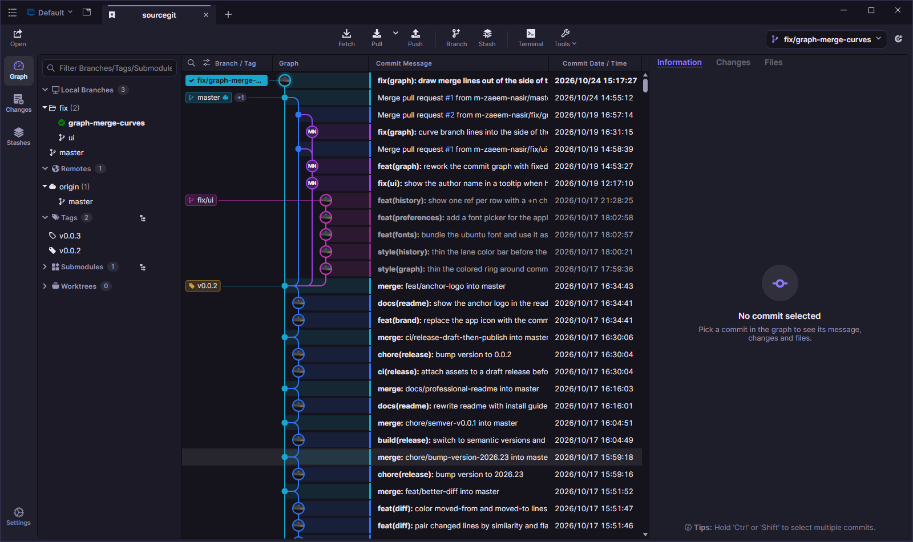
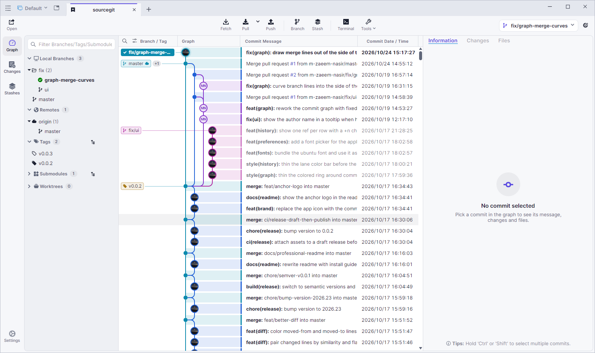
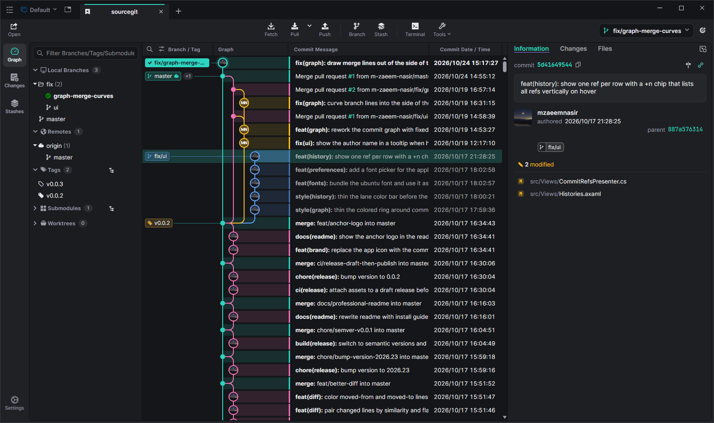

<div align="center">


# Commit Dock

**A fast, graph-first Git client for Windows, macOS and Linux.**

See your whole history at a glance, stage and commit next to the graph, and review changes with diffs that understand what you actually did.

[](https://github.com/mzaeemnasir/Commit-Dock/releases/latest)
[](https://github.com/mzaeemnasir/Commit-Dock/releases)
[](https://github.com/mzaeemnasir/Commit-Dock/actions/workflows/release.yml)
[](LICENSE)


[**Download**](https://github.com/mzaeemnasir/Commit-Dock/releases/latest) ·
[Features](#features) ·
[Installation](#installation) ·
[Build from source](#building-from-source) ·
[Report a bug](https://github.com/mzaeemnasir/Commit-Dock/issues)



</div>

## Contents

- [Features](#features)
- [Screenshots](#screenshots)
- [Installation](#installation)
- [Getting started](#getting-started)
- [Configuration](#configuration)
- [Building from source](#building-from-source)
- [Releasing](#releasing)
- [Contributing](#contributing)
- [License](#license)

## Features

### History and graph
- **Readable commit graph** with straight colored lanes, rounded merge and branch curves, author avatars and branch/tag labels right next to the lines they belong to
- **Work-in-progress row** at the top of the graph shows your uncommitted changes; click it to review and commit without leaving the history
- **Diffs over the graph**: open any changed file in place, press `Esc` to go back
- Fast search by message, author, committer, file path or SHA, plus file and folder history and blame

### Staging and committing
- One-click **Stage All** / **Unstage All**, per-file and per-line staging, and a full-width **Commit** / **Commit & Push** row
- Amend, sign-off, `--no-verify`, commit templates and a built-in **Conventional Commits** helper
- **AI-written commit messages** with any OpenAI-compatible service, including local models through Ollama

### Diffs that make sense
- **Histogram diff algorithm**, so changes line up on real code instead of stray braces and blank lines
- **Word-level highlights** that also work when a block of lines grows or shrinks
- **Moved-code detection**: blocks moved within a file are tinted instead of shown as a large delete plus add
- Side-by-side or unified view, syntax highlighting, image diffs (side-by-side, swipe, blend) and LFS-aware diffs

### Everyday Git, in a GUI
- Clone, fetch, pull, push, merge, rebase (including **interactive rebase**), cherry-pick, revert and reset
- Branches, remotes, tags, stashes, submodules and **worktrees**, with a branch switcher in the toolbar showing ahead/behind counts
- Git LFS, Git Flow, bisect, archives, patches and a full Git command log
- Create pull requests on GitHub, GitLab, Gitea, Gitee and Bitbucket

### Built to stay out of your way
- **Command palette** (`Ctrl+Shift+P` / `⌘⇧P`) and keyboard shortcuts for everything; press `F1` to see them
- **Workspaces** and tabs for juggling many repositories, plus custom actions for your own scripts
- **Eight themes**: Dark (default), Obsidian, Abyss, Forest, Ember, Nebula, Arctic and Light, or load your own theme file
- Available in 16 languages: English, Deutsch, Ελληνικά, Español, Français, עברית, Bahasa Indonesia, Italiano, 日本語, 한국어, Português (Brasil), Русский, தமிழ், Українська, 简体中文 and 繁體中文

## Screenshots

| Light theme | Obsidian theme |
|---|---|
|  |  |

## Installation

Download the file for your system from the [latest release](https://github.com/mzaeemnasir/Commit-Dock/releases/latest).

| System | File | How to install |
|---|---|---|
| **Windows** (x64 / ARM64) | `CommitDock-v<version>-setup-x64.exe` | Run the installer. No admin rights needed; it installs for your user by default. |
| Windows, portable | `CommitDock-v<version>-win-x64.zip` | Unzip anywhere and run `CommitDock.exe`. |
| **macOS** (Apple Silicon / Intel) | `CommitDock-v<version>-osx-arm64.zip` / `-osx-x64.zip` | Unzip and move `CommitDock.app` to *Applications*. |
| **Linux** (Debian / Ubuntu) | `CommitDock-v<version>-linux-amd64.deb` | `sudo apt install ./CommitDock-v<version>-linux-amd64.deb` |
| **Linux** (Fedora / openSUSE) | `CommitDock-v<version>-linux-x86_64.rpm` | `sudo dnf install ./CommitDock-v<version>-linux-x86_64.rpm` |
| **Linux** (any distribution) | `CommitDock-v<version>-linux-amd64.AppImage` | `chmod +x` the file and run it. |

ARM64 builds are published for every platform as well.

> [!NOTE]
> Release builds are not code-signed yet.
> - **Windows:** if SmartScreen shows *"Windows protected your PC"*, choose **More info → Run anyway**.
> - **macOS:** if macOS reports the app as damaged or from an unidentified developer, run `sudo xattr -cr /Applications/CommitDock.app` once.

### Requirements

Commit Dock runs the Git command line under the hood, so **Git 2.25.1 or newer** must be installed.

- **Windows:** use the official [Git for Windows](https://git-scm.com/download/win). MSYS Git is not supported.
- **macOS:** install [Git Credential Manager](https://github.com/git-ecosystem/git-credential-manager/releases) for HTTPS remotes.
- **Linux:** install [Git Credential Manager](https://github.com/git-ecosystem/git-credential-manager/releases) or `git-credential-libsecret`, and `xdg-utils` so folders open in your file manager.

## Getting started

1. Launch Commit Dock and choose **Open** to add a folder you already have, or **Clone** to get one from a remote.
2. Your repositories appear on the welcome page; double-click one to open it in a tab.
3. Pick any commit in the graph to see its details, or click the **WIP** row to stage and commit your changes.

You can also start it from a terminal:

```sh
CommitDock <DIR>                    # open a repository (reuses a running window)
CommitDock --history <FILE_OR_DIR>  # show the history of a file or folder
CommitDock --blame <FILE>           # blame a file (HEAD version)
```

On Linux the command is `commitdock`.

## Configuration

### Where settings are stored

| System | Location |
|---|---|
| Windows | `%APPDATA%\CommitDock` |
| macOS | `~/Library/Application Support/CommitDock` |
| Linux | `${XDG_CONFIG_HOME}/CommitDock` for settings, `${XDG_CACHE_HOME}/CommitDock` for avatars and logs |

> [!TIP]
> **Portable mode:** create a folder named `data` next to the Commit Dock executable and it will keep all settings there instead (Windows and Linux AppImage).
> You can open the settings folder at any time from the main menu.

### AI commit messages

Open **Preferences → AI** and add a service with an OpenAI-compatible API:

| Service | Server | API key |
|---|---|---|
| OpenAI | `https://api.openai.com/v1` | Required |
| Ollama (local) | `http://localhost:11434/v1` | Not needed |
| Any other compatible service | its OpenAI-style base URL | Depends on the service |

Then use the AI button in the commit message box to draft a message from your staged changes.

### External editors and tools

Commit Dock detects Visual Studio Code (and Insiders), VSCodium, Cursor, Sublime Text, Zed, Visual Studio (Windows only) and JetBrains IDEs installed through JetBrains Toolbox. To add a portable install or hide one, create `external_editors.json` in the settings folder:

```json
{
  "tools": {
    "Visual Studio Code": "D:\\VSCode\\Code.exe"
  },
  "excludes": [
    "Visual Studio Community 2019"
  ]
}
```

Your configured Git diff/merge tool can be launched from any diff via **Open in external tool**.

### Conventional commit types

To use your own commit types for a repository, create a JSON file like the one below and select it under **Repository settings → Conventional Commit Types**:

```json
[
  { "Name": "New Feature", "Type": "feat", "Description": "Adding a new feature" },
  { "Name": "Bug Fix", "Type": "fix", "Description": "Fixing a bug" }
]
```

### Platform tips

- **Windows:** `git-flow` is no longer bundled with Git for Windows 2.51.1+. Install [git-flow-next](https://github.com/gittower/git-flow-next/releases), rename it to `git-flow` and put it on your `PATH`.
- **macOS:** if tools from your shell are not found, run `echo $PATH > ~/Library/Application\ Support/CommitDock/PATH` to share your shell's `PATH` with the app.
- **Linux:** on mixed-DPI setups set [`AVALONIA_SCREEN_SCALE_FACTORS`](https://github.com/AvaloniaUI/Avalonia/wiki/Configuring-X11-per-monitor-DPI); if accented characters cannot be typed, set `AVALONIA_IM_MODULE=none`.

## Building from source

You need the [.NET 10 SDK](https://dotnet.microsoft.com/download) and Git.

```sh
git clone --recurse-submodules https://github.com/mzaeemnasir/Commit-Dock.git
cd Commit-Dock
dotnet run --project src/CommitDock.csproj
```

The editor component lives in a submodule (`depends/AvaloniaEdit`); if you cloned without `--recurse-submodules`, run `git submodule update --init`.

To produce an optimized, self-contained build:

```sh
dotnet publish src/CommitDock.csproj -c Release -r <runtime> -o publish
```

where `<runtime>` is one of `win-x64`, `win-arm64`, `osx-x64`, `osx-arm64`, `linux-x64` or `linux-arm64`. Native builds need the platform's C++ toolchain (Visual Studio C++ build tools on Windows, Xcode command-line tools on macOS, `clang` on Linux).

To build the Windows installer locally (requires [Inno Setup 6](https://jrsoftware.org/isinfo.php)):

```powershell
pwsh build/scripts/package.win-installer.ps1
```

## Releasing

Releases are built and published by GitHub Actions.

1. Set the new version in the [`VERSION`](VERSION) file (for example `0.0.2`) and merge it into `master`.
2. Tag that commit and push the tag; the tag message becomes the release notes:
   ```sh
   git tag -a v0.0.2 -m "CommitDock v0.0.2"
   git push origin v0.0.2
   ```
3. The [release workflow](.github/workflows/release.yml) builds every platform, packages the installers and archives, and attaches them to a new GitHub release.

## Contributing

Contributions are welcome. Please branch from the latest `master`, keep one feature or fix per branch, and open a pull request against `master`.

Found a bug or have an idea? [Open an issue](https://github.com/mzaeemnasir/Commit-Dock/issues).

### Translations

Translation progress is tracked in [TRANSLATION.md](TRANSLATION.md). The helper script walks you through missing strings for a language:

```sh
python translate_helper.py pt_BR           # translate missing keys interactively
python translate_helper.py pt_BR --check   # only list missing keys
```

Language files live in `src/Resources/Locales/`, with `en_US.axaml` as the reference.

## License

Commit Dock is released under the [MIT License](LICENSE). Third-party components and their licenses are listed in [THIRD-PARTY-LICENSES.md](THIRD-PARTY-LICENSES.md).
